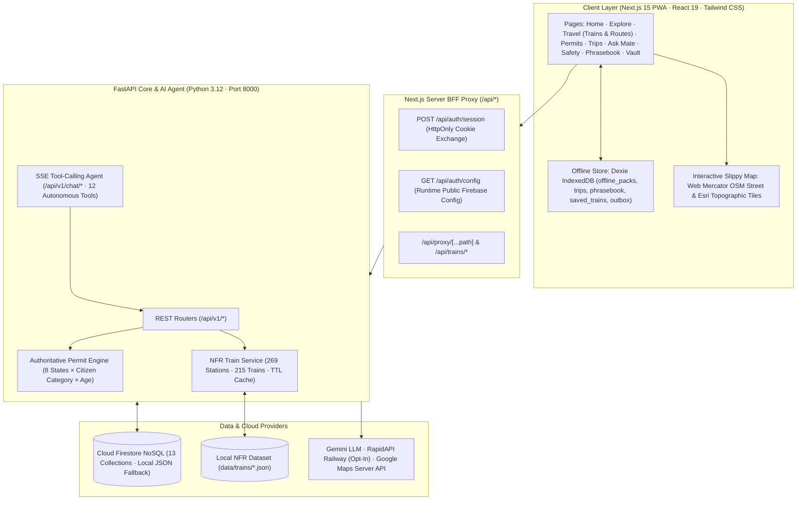

# NorthEast TravelMate — System Architecture & API Reference

## 1. High-Level Architecture

NorthEast TravelMate is an offline-first monorepo combining a **Next.js 15 App Router PWA** (`apps/web`), a **Python 3.12 FastAPI Core API** (`services/api`), a **Tool-Calling AI Travel Agent** (`services/agent`), and **Firebase Authentication + Cloud Firestore** (`services/common`).



---

## 2. Monorepo Directory Structure

```text
northeast-travel-mate/
├── .github/workflows/
│   └── ci-cd.yml                  # Automated Pytest, TypeScript check, Next.js build & GHCR Docker publish
├── apps/
│   └── web/                       # Next.js 15 App Router PWA (React 19, TypeScript, Tailwind CSS)
│       ├── public/                # Brand logo, PWA manifest, Service Worker (sw.js), 28 landmark photos (/places/)
│       └── src/
│           ├── app/               # App Router pages & BFF API route handlers (/api/auth/*, /api/proxy/*, /api/trains/*)
│           ├── components/        # Layout (AppShell, Providers), Maps (NEMap), Trains (*), UI Primitives
│           └── lib/               # Firebase Auth client, Dexie offline DB, Zustand store, i18n, NFR local data
├── data/
│   ├── scripts/                   # Data maintenance utilities (Wikipedia landmark photo fetcher)
│   ├── seed/                      # 8-state curated baseline data & Cloud Firestore seeder (seed_firestore.py)
│   └── trains/                    # NFR stations (269), NE railheads (14), scheduled trains (215) & sync scripts
├── docs/
│   ├── assets/                    # Official brand logo and documentation media
│   ├── ARCHITECTURE.md            # System architecture, data flow, and REST API reference
│   ├── DEPLOYMENT.md              # Cloud deployment guide (Render, Vercel, Docker Compose, CI/CD)
│   ├── DESIGN_SYSTEM.md           # Color tokens, WCAG 2.2 AA contrast audit, typography, and component specs
│   ├── FIREBASE_SETUP.md          # Firebase Authentication, Cloud Firestore, and security rules setup
│   └── SECURITY.md                # Security posture, secret protection, RBAC, and DPDP Act compliance
├── infra/
│   ├── firebase/                  # firestore.rules, firestore.indexes.json, storage.rules, firebase.json
│   ├── Dockerfile.api             # Production Python 3.12 FastAPI container image
│   ├── Dockerfile.agent           # Standalone AI Agent container image
│   ├── Dockerfile.web             # Multi-stage Node 22 Alpine Next.js PWA container image
│   ├── Dockerfile.worker          # Background alert & freshness worker image
│   └── docker-compose.yml         # Full-stack local/VPS Compose orchestration
├── packages/
│   └── shared/                    # Shared TypeScript interfaces, API client, and OpenAPI schema generator
├── services/
│   ├── agent/                     # Tool-calling AI travel assistant (Gemini / OpenAI + deterministic fallback)
│   ├── api/                       # FastAPI Core REST API routers, auth dependencies, and 30 pytest tests
│   ├── common/                    # Shared config, Firestore/Local repository, permit engine, train models, TTL cache
│   └── worker/                    # Scheduled permit staleness and alert worker
├── .dockerignore                  # Excludes secrets, virtualenvs, and build caches from Docker contexts
├── .env.example                   # Environment template (zero live secrets)
├── .gitignore                     # Strict exclusion of .env, service-account.json, and build artifacts
├── package.json                   # Root workspace scripts
└── render.yaml                    # Render.com 1-click multi-service deployment blueprint
```

---

## 3. REST API Reference (`/api/v1/*`)

| Group | Method & Path | Description |
| :--- | :--- | :--- |
| **System** | `GET /api/v1/health` | Service health, version, and active Firebase mode (`firestore` / `local`). |
| **Auth & Profile** | `POST /api/v1/auth/session` | Verifies Firebase ID token / PoC token and sets `HttpOnly` session cookie. |
| | `GET /api/v1/me` / `PUT /api/v1/me` | Reads or updates traveler profile and records itemized DPDP consent audit logs. |
| | `DELETE /api/v1/me` | Permanently deletes user profile, trips, vault documents, and chat threads (DPDP right to erasure). |
| **Explore & Culture** | `GET /api/v1/states` | Lists all 8 North-East states with centers and metadata. |
| | `GET /api/v1/places/search` | Searches curated destinations by state, category, featured flag, and query. |
| | `GET /api/v1/places/nearby` | Haversine distance search around GPS coordinates. |
| | `GET /api/v1/specialities` | Lists regional cuisine, handloom textiles, and heritage crafts by state. |
| | `GET /api/v1/festivals` | Lists annual cultural and indigenous festivals with dates and official links. |
| | `GET /api/v1/phrasebook` | Returns multilingual travel phrases across 6 regional languages. |
| **Permits (ILP/PAP)** | `GET /api/v1/permits/checklist` | Computes personalized ILP/PAP/RAP requirements by state, destination, citizen category, and age. |
| **Trains & Routes** | `GET /api/v1/trains/stations` | Zero-API local autocomplete across 14 NE destinations and 269 NFR stations. |
| | `GET /api/v1/trains/railheads` | Cached bundle of NE railheads, road distances, and verified permit hints. |
| | `GET /api/v1/trains/search` | Searches NFR trains between station codes on a journey date. |
| | `GET /api/v1/trains/{trainNo}/route` | Returns full stop-by-stop schedule and distances for a 5-digit train number. |
| | `GET /api/v1/trains/{trainNo}/status` | Returns live status (when provider enabled) or labelled scheduled timetable. |
| | `POST /api/v1/travel/options` | Multi-modal comparison (Shared Sumo, Bus, Train, Flight, Ferry, Self-Drive). |
| **Trips & Budget** | `POST /api/v1/trips/generate` | Generates a budget-aware day-by-day draft itinerary with stops and costs. |
| | `GET /api/v1/trips` / `POST /api/v1/trips` | Lists or creates saved trips. |
| | `GET /api/v1/trips/{id}` | Returns full trip timeline, day items, permit tasks, expenses, and budget summary. |
| **Agentic Chat** | `POST /api/v1/chat/threads/{id}/messages` | Streams SSE tool calls (`tool`), UI cards (`card`), permit citations (`citation`), and text deltas (`delta`). |
| **Safety & Vault** | `GET /api/v1/alerts` / `GET /api/v1/safety/helplines` | Active highway/weather advisories and state emergency helplines (`112`). |
| | `GET /api/v1/documents` / `POST /api/v1/documents` | Private Document Vault for permit PDFs, ID copies, and tickets. |
| **Offline Sync** | `GET /api/v1/offline/packs` / `POST /api/v1/sync` | Downloadable 8-state offline bundles and optimistic version-checked mutation sync. |
